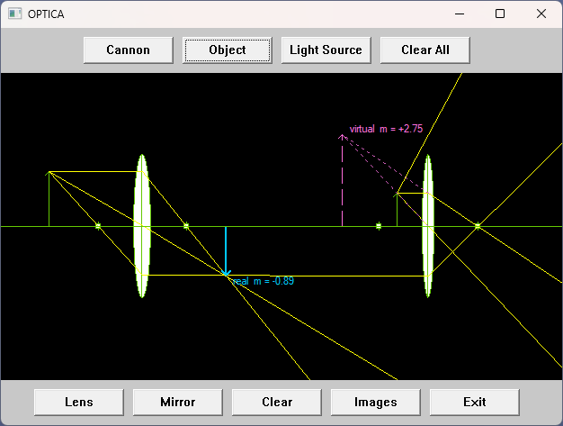

# Óptica

*Óptica*, or for simplicity and to avoid using Latin characters, *Optica*, is a tool for teaching geometrical optics. Based on the previous work [OptiC](https://github.com/Samuel85/OptiC), this project improves its design and fixes previous bugs, adding new features like fullscreen mode and virtual and real images with labels. Written in C++20 and using AI, this project was more of a challenge: to explore AI's ability to revive an almost 20-year-old project and bring it to new platforms.

<center>

</center>

# Changes
* Replaces old code for linked lists with modern C++ to avoid memory leaks.
* Rewrites the ray tracing algorithm.
* Decouples the old monolithic design with the Model-View-Controller (MVC) pattern.
* New _Linux_, _Android_ and _iOS_ ports using _SDL3_ and Dear _ImGUI_ (See the [screenshot directory](./screenshots/)).

# Builds
Every push to `main` and every pull request is built and tested on all platforms by
[GitHub Actions](.github/workflows/build.yml). The packages are kept with each run (the
*Artifacts* of the run in the *Actions* tab):

| Platform | Package | Notes |
|---|---|---|
| Windows | `optica-<version>-windows-x64.zip` | the Win32 + GDI program |
| Linux | `optica-<version>-linux-x86_64.tar.gz` | SDL3 + Dear ImGui; X11 |
| Android | `optica-<version>-android.apk` | signed with a debug key: allow installing unknown apps |
| iOS | `optica-<version>-ios-simulator.zip` | `Optica.app` for the iOS Simulator |
| iOS | `optica-<version>-ios-unsigned.ipa` | must be signed with your certificate before it installs |

To publish a release with these packages, push a tag starting with `v`:

```
git tag v1.0.0
git push origin v1.0.0
```
